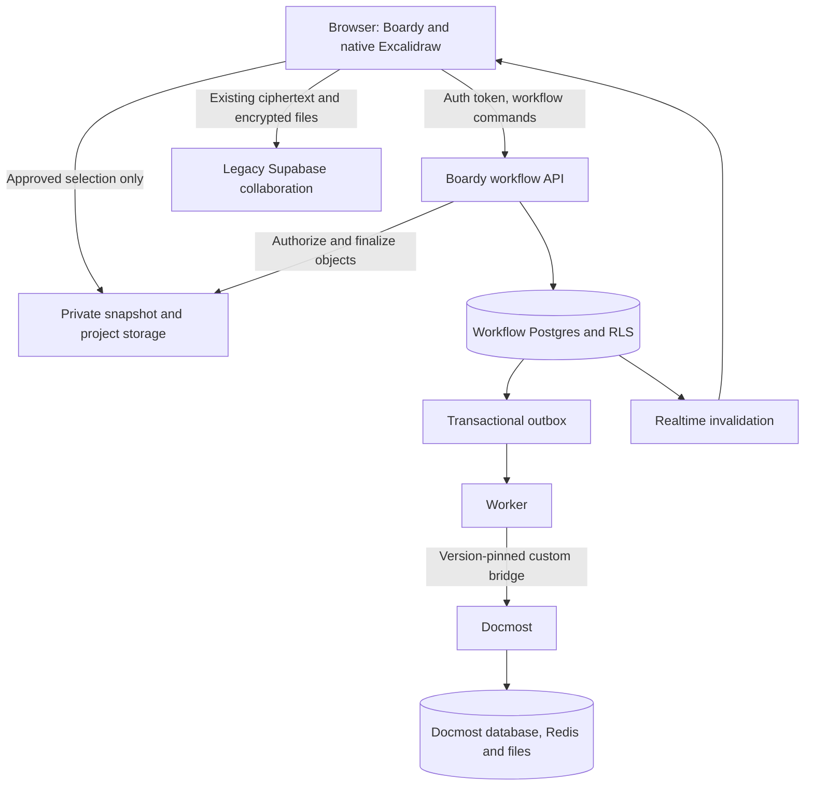
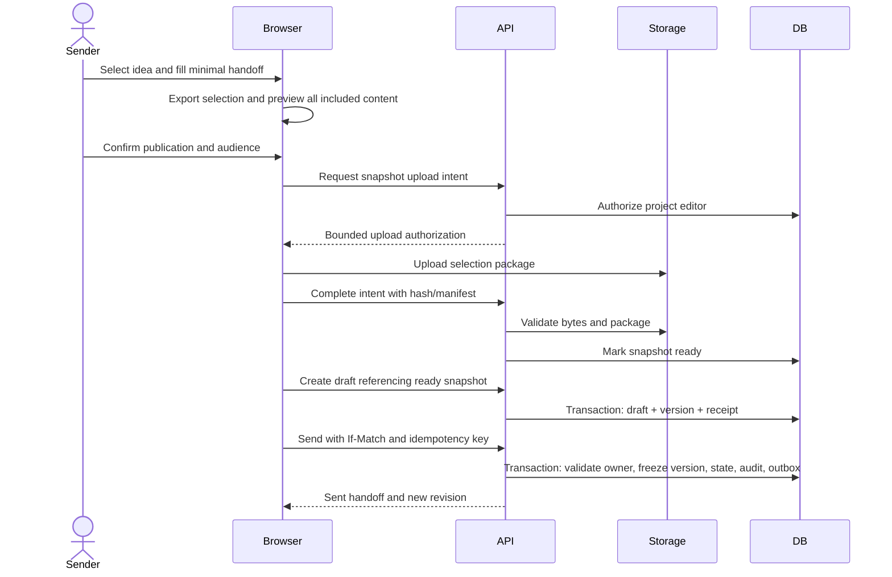
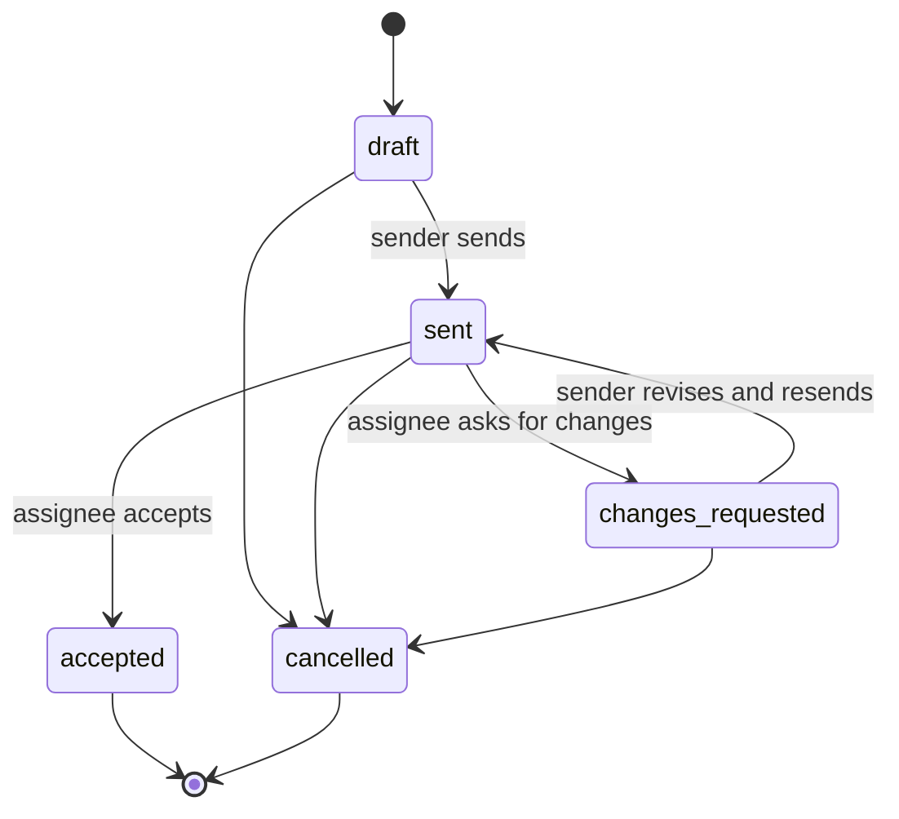

# Data flows

## System view



The browser's board key does not flow to the workflow API, worker, AI provider, or Docmost. Published handoff context is a separate server-readable object. Docmost authentication is its own trust boundary; Supabase tokens are not assumed interchangeable.

## Create and send



The publish action is the intentional privacy boundary. If validation fails, the handoff remains unsent and the user can fix it. No half-published snapshot is exposed to recipients.

## Accept, then add detail

```mermaid
sequenceDiagram
  actor Recipient
  participant Boardy
  participant API
  participant DB
  participant Worker
  participant Docmost
  Recipient->>Boardy: Open assigned handoff
  Boardy->>API: Fetch authorized handoff and snapshot
  Recipient->>Boardy: Accept
  Boardy->>API: Accept with revision and idempotency key
  API->>DB: Commit accepted version and activity
  API-->>Boardy: Accepted; Add detail available
  Recipient->>Boardy: Choose template and Create document
  Boardy->>API: Request document for accepted version
  API->>DB: Commit job and outbox
  API-->>Boardy: 202 + job ID
  Worker->>DB: Claim job with lease
  Worker->>Docmost: Create through verified custom open-source bridge
  Docmost-->>Worker: Canonical page identity
  Worker->>DB: Store link and complete job
  Boardy->>API: Fetch job after invalidation or bounded refresh
  API-->>Boardy: Ready link
  Recipient->>Docmost: Open native editor and refine detail
```

Without the configured custom open-source bridge, export Markdown from the accepted handoff and import it through the community Markdown importer. Manual document links are enabled only for configured instances/spaces with verified access alignment. Document failure never rolls back acceptance.

## Lifecycle



Execution status and document status are independent. `accepted` does not mean `done`, and `document ready` does not mean `accepted`. UI and analytics must keep these distinctions.

## Failure and recovery

| Boundary | Failure | Recovery |
| --- | --- | --- |
| Browser → API | Timeout after commit | Retry same idempotency key and identical body |
| Upload → finalize | Object exists, DB not finalized | Retry finalization; sweep expired orphan only after checking references |
| API → DB | Stale revision | Return 412, preserve draft, refresh and reconcile explicitly |
| Worker → Docmost | Timeout with unknown create outcome | Mark needs_reconciliation; search/verify correlation through supported mechanism before retry |
| Realtime → browser | Missed event | Reload authoritative paginated state on reconnect |
| Access sync | Boardy and Docmost diverge | Disable integrated actions, revoke upstream access, reconcile; never treat hiding a link as revocation |
| Delete → object store | Partial deletion | Tombstone remains; bounded cleanup retries and operational alert |
