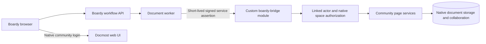

# Docmost Community integration

**Decision: self-host the open-source core and build a small integration bridge. No enterprise subscription is part of the architecture.**

This supersedes the earlier enterprise-adapter approach. Keep the product order: idea → handoff → acceptance → useful detail. Docmost provides the document experience; Boardy provides the workflow. The bridge is proposed engineering work, not a feature already available in Community.

## What to reuse and what to build

| Need | Community-first approach |
| --- | --- |
| Documents | Reuse native collaborative editor, page hierarchy, history and attachments |
| Project boundaries | Map each Boardy project to a private Docmost space with native space roles |
| Diagrams | Preserve native diagram support; main ideation stays on the Boardy canvas |
| Basic document search | Use native page search; do not assume attachment full-text search |
| Initial document transfer | Boardy exports Markdown; user imports it through native Community UI |
| Programmatic draft creation | Build our own namespaced bridge around core page services |
| Reusable brief formats | Boardy-owned Markdown recipes in versioned code; no paid Templates dependency |
| Handoff approvals | Boardy lifecycle and audit events; no paid page approval workflow |
| Identity | Native community login plus explicit account linking; no paid SAML/OIDC or SCIM |
| AI drafting | Optional Boardy service using approved context; no Docmost AI dependency |
| Per-page private exceptions | Defer; space membership is the initial boundary |
| Public-link prevention | Implement and test an independent private-deployment policy; do not assume paid “disable public sharing” controls exist |
| Office imports | Start with Markdown/HTML; do not promise paid DOCX/PDF/Confluence importers |

Sources: [edition distinctions](https://docmost.com/docs/), [spaces](https://docmost.com/docs/user-guide/spaces), [import/export](https://docmost.com/docs/user-guide/import-export). The docs describe multiple editions together; a feature appearing on a general guide is not proof it is free.

## Integration choices

**Chosen:** a small maintained fork with a `boardy-bridge` NestJS module using community services. Host it separately from Boardy. Keep modifications isolated and record the upstream commit. This provides our own contract and room to implement reliable correlation and access checks.

**Bootstrap:** native login and Markdown import/export. This proves the product without building an identity platform. A manually entered link remains an unverified convenience link until the bridge can verify its page and project-space mapping; do not display it as synchronized or authorize content through it. The typed document-links API continues to accept only verified links.

**Avoid:** a shared admin login replayed by workers, scraping browser endpoints from Boardy, external SQL writes into native document tables, or removing license checks to activate paid code. Community controllers can inform our implementation, but they are not a supported external API contract.

## Source-grounded extension points

Inspected upstream commit: `6205bbeb908fe846f87dd6a2cbf562e24777db38`; package version `0.96.0`. These observations do not constitute a tested integration.

| Source path | Reuse implication |
| --- | --- |
| `apps/server/src/core/page/page.controller.ts` | Page creation checks space or parent-page permissions before calling `PageService.create`; bridge must preserve equivalent checks |
| `apps/server/src/core/page/dto/create-page.dto.ts` | Native DTO accepts spaceId, optional parent/title/content, and json/markdown/html formats; start with Markdown |
| `apps/server/src/common/interceptors/http-response.interceptor.ts` | Native success envelope is `{ data, success, status }` |
| `apps/server/src/common/guards/jwt-auth.guard.ts` | Native authentication is more than a raw JWT check; preserve session/scope boundaries, do not pass Supabase tokens into it as if equivalent |
| `apps/server/src/collaboration/` | Native collaboration, persistence, and history own document editing state |
| `apps/server/src/core/space/space.controller.ts` | Core space boundary is the place to inspect membership/admin operations before wiring synchronization |

Some core controllers reference shared hooks or optional features. Audit transitive imports before choosing extension points. The implementation must boot and execute the selected path with no EE functionality enabled. Do not assume that “outside an ee folder” alone proves an entire call graph is community-only.

## Proposed bridge topology

Bridge routes are **our additions**, prefixed `/api/boardy-bridge/v1`. Use POST action endpoints and Docmost-style response envelopes. The [bridge OpenAPI](bridge-openapi.json) specifies draft creation, lookup, access verification and reconciliation. It is separate from the enterprise `/api` key feature and from native interactive-session routes.

## Identity and authorization

1. User logs into Boardy and Docmost separately in the first release.
2. Boardy creates a one-time linking challenge bound to its authenticated user and intended Docmost instance. A bridge UI action inside the authenticated Docmost session redeems it server-to-server. Both sides must prove possession of their account sessions. Bind issuer, audience, nonce and expiry; require CSRF/origin protection for the browser leg.
3. Persist `(instanceId, boardyUserId, docmostUserId, docmostWorkspaceId)` with confirmation time and revocation status. Never auto-link on matching email alone or accept a browser-supplied upstream user ID as proof.
4. Background requests use an independently implemented asymmetric service assertion: exact issuer/audience, expiry no longer than 60 seconds, unique request nonce and least-privilege scope. Private signing keys stay with the worker; bridge verifies a rotated public-key allowlist. This is our authentication design, not Docmost API-key functionality.
5. `actorId` in a bridge request must map to a confirmed active linked account. Verify Boardy project membership with a fresh authenticated server check, mapped Docmost workspace/space, native actor permissions, and requested operation. Fail closed if checks cannot be completed.
6. Worker authentication authorizes transport only; it must not confer arbitrary user privileges. Recheck actor and membership at job execution, not just queue creation.

Account-link endpoints and space provisioning are not specified as complete public contracts yet; the phase-4 implementation must add their schemas and negative tests before enabling the bridge. Early pilots can establish mappings through a controlled dual-login administrative setup with recorded proof. This is not seamless SSO. A custom session bridge can be considered later, with its own security design; it must cover native websockets, logout, account recovery and revocation rather than only the first HTML page.

## Space and sharing policy

Map Boardy owner → Docmost Full Access, editor → Can Edit, viewer → Viewer. Initial provisioning is controlled and audited; no automatic inclusion of all workspace users or broad groups. Check actual effective access including groups and workspace administrators. An upstream administrator is privileged; do not promise project isolation from Docmost instance administrators.

Keep one space per project. Do not use paid page-level permissions as a dependency. Membership changes create a durable synchronization task and mark parity unverified until checked. Boardy revocation cannot retract previously downloaded content or remove direct upstream access by hiding a link. On removal, perform upstream revocation first for the document side, retry failures with an alert, and make the temporary drift visible to administrators. Shared-host rollout requires tested revocation; manual membership sync is pilot-only.

Community permits public sharing, while centralized disabling controls are listed as paid. For private Boardy projects, independently implement a server-side policy in the maintained fork that denies public share creation and public serving of integrated content, including attachments and previews. Cover native routes as well as bridge routes; hiding UI alone is insufficient. Do not copy an EE implementation or enable its feature flag. Initially dedicate the instance to private integrated projects to avoid mixed sharing policies. Until the policy and direct-route tests pass, use only non-sensitive pilot content.

## Draft creation and correctness

The worker takes an accepted handoff version, renders a Boardy Markdown recipe, and calls `pages/create` with a correlation ID. The bridge checks the actor and mapped space, validates content, and invokes native page creation with Markdown format. Return canonical page identity; derive its URL using native routing logic, never title concatenation.

Keep bridge receipts/correlation records in dedicated extension tables in the Docmost database. Require a unique `(workspaceId, correlationId)` plus request hash. Commit native page creation and correlation binding atomically by carrying a transaction through supported core internals in the fork. Whether the existing service accepts that transaction must be checked during implementation; refactoring it is custom work. If atomic creation cannot be demonstrated, ambiguous results enter reconciliation and automated retry is disabled. Do not claim exactly-once behavior from an HTTP header alone.

A same-correlation/different-body request returns conflict. Reconciliation returns `found`, `pending`, or `absent`; `absent` permits retry only once the original attempt is known terminated and no page was committed. Worker leases alone do not prove that. The bridge must preserve content conversion, collaboration state and history setup through the native creation service.

No automatic update of a page after creation. Users edit through Docmost. Later handoff amendments create new detail or explicit user-reviewed changes, never overwrite live collaborative content.

## Storage additions

Boardy stores confirmed identity links, project-space mappings, job status and page references. Docmost stores page bodies, native attachments/history, and the bridge's correlation ledger. Signing keys live in the deployment secret store. Neither system gets the original encrypted board key. A generated document uses only published selected context and explicitly included ready files.

Use stable authorized Boardy links for source files; do not embed expiring signed URLs as permanent document images. If copying an asset into Docmost is necessary, implement it through native attachment services and record the copied immutable source version. It becomes a separately retained copy subject to Docmost access/deletion policy.

## Community build and maintenance

The repository identifies AGPL core and separately licensed EE directories. Keep notices and provide corresponding source for the modified network-served AGPL program as required by its license. Record the exact deployed commit and patch set. Do not assume service separation by itself resolves every license question about combined code; document the actual dependency boundary. This is a source-compliance task, not a purchase requirement.

Pin image/source revisions, keep bridge changes isolated, and run contract, creation/history, authorization, websocket, import/export, and revocation tests on upgrades. Build without enterprise credentials and verify no licensed module is needed for selected paths. Budget maintenance and hosting costs even though there is no enterprise subscription.

## Phase-4 acceptance criteria

- Community deployment boots and the full selected flow works without a license key.
- A linked editor creates one editable native page from an accepted handoff; a viewer or foreign-project actor cannot.
- Retry, process crash and timeout do not create untracked duplicates; ambiguous results are surfaced.
- Content/history/collaboration remain native and survive restart.
- Direct UI/API/websocket/file access respects effective permissions and removal tests.
- Private-project public links cannot be created or served through alternate native routes.
- No enterprise code copied, paid features unlocked, shared admin session replayed, or encrypted board key disclosed.
- Source release, upgrade procedure and restore drill accompany the deployed fork.
