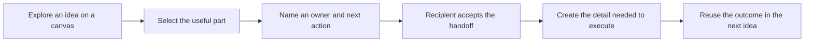

# Idea → handoff → detail

**Make an idea actionable before asking people to write a document.**

Boardy is the visual project workspace where a team explores an idea, hands off a concrete next step, and develops the supporting detail when the recipient needs it.

| Document | Read it to |
| --- | --- |
| [Visual overview](overview.html) | See the product sequence and system boundaries at a glance |
| [Vision](VISION.md) | Understand the customer, business thesis, and boundaries |
| [PRD](PRD.md) | Build the workflow and its acceptance criteria |
| [Design direction](DESIGN-DIRECTION.md) | Keep the experience crisp, modern, and consistent |
| [Technical requirements](TRD.md) | Understand integration boundaries and reliability requirements |
| [Architecture decisions](adr/README.md) | Understand decisions and their consequences |
| [Open-source integration](DOCMOST-OSS-INTEGRATION.md) | Reuse community services and implement the missing bridge |
| [Bridge OpenAPI](bridge-openapi.json) | Read the custom service-to-service document contract |
| [API specification](API.md) | Understand custom commands and native integration contracts |
| [OpenAPI contract](openapi.json) | Read the proposed Boardy HTTP API mechanically |
| [Data model](DATA-MODEL.md) | Understand ownership, permissions, storage, and retention |
| [Data flows](DATA-FLOWS.md) | Follow information across browser, services, and storage |
| [Implementation plan](IMPLEMENTATION-PLAN.md) | Deliver the system in bounded, testable phases |
| [Sources and baseline](SOURCES.md) | Verify evidence, upstream contracts, and open gates |

## Open-source-only deployment

Use Docmost Community core plus a small Boardy-maintained bridge. No enterprise license, enterprise API keys, paid SSO, paid Templates, or paid feature flags are required by this plan. Read [Open-source integration](DOCMOST-OSS-INTEGRATION.md) before touching document integration. Its custom modules are proposed work, not upstream capabilities.

## Status

Design baseline: **2026-09-16**. Repository inspected at `7fa6d450bbd1bbfb31670e5373b463cd5e04f33b`; local Excalidraw package reports `0.18.0`. Everything called **proposed** is a design, not a shipped capability. Existing behavior is called out separately. This is an implementation brief, not authorization to deploy or migrate production.

## Read order for agents

1. Read repository `AGENTS.md`, `PRODUCT.md`, and `DESIGN.md` first.
2. Read this index, `PRD.md`, and `adr/README.md` before implementation.
3. Read the relevant API, data, design, and phase requirements.
4. Check actual code and upstream version before applying a contract.
5. Preserve the existing encrypted canvas. Do not silently publish or decrypt it.
6. Keep upstream Excalidraw editor code separate from Boardy workflow code.
7. Implement one phase at a time. Do not introduce enterprise-only Docmost APIs or claim an integration works without testing it.

## The product invariant

A document is never required to send or accept a handoff. An attachment or existing document can provide optional context at any stage. Creating new detailed documents is deliberately downstream of accepted ownership.
